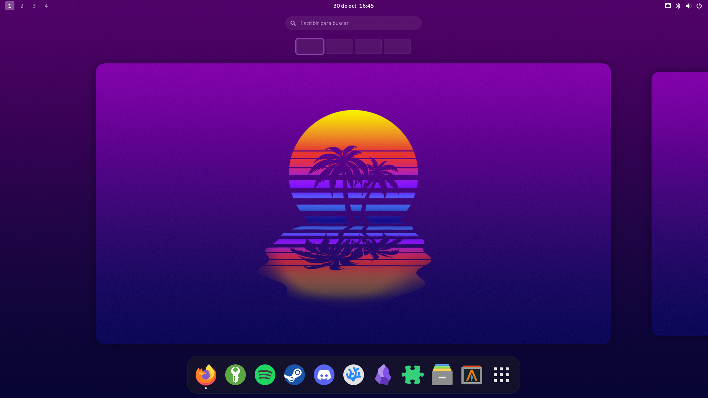

# CENTRIX
**Centrix** is a collection of **Bash** scripts developed to customize and configure the **GNOME** desktop environment on **Debian GNU/Linux** systems. The project enables the automation of the installation, removal, and configuration of programs according to the preferences and criteria defined by its developer, facilitating the preparation of a personalized desktop environment.

- **Automation:** Simplifies initial system setup using Bash scripts.
- **Customization:** Tailors the desktop environment to the developer's preferences.
- **Package management:** Installs and removes programs using tools available in **Debian GNU/Linux**.
- **Tool configuration:** Enables the automated installation and setup of utilities and applications.
- **Modular configuration:** Organizes tasks into independent scripts to facilitate maintenance and modification.
- **Flexibility:** Allows for the adaptation of installations and configurations based on each user's needs.

 

## SOFTWARE:
- **JetBrains Mono** (*https://www.jetbrains.com/es-es/lp/mono/*)
- **Gnome Extension App** (*https://apps.gnome.org/es/Extensions/*)
- **Papirus** (*https://github.com/PapirusDevelopmentTeam/papirus-icon-theme*)
- **GNOME-Tweaks** (*https://gitlab.gnome.org/GNOME/gnome-tweaks*)
- **Alacritty** (*https://alacritty.org/*)
- **Fastfetch** (*https://github.com/fastfetch-cli/fastfetch*)
- **Flatpak** (*https://flatpak.org/*)
- **cURL** (*https://curl.se/*)
- **Wget** (*https://www.gnu.org/software/wget/*)
- **PipX** (*https://pipx.pypa.io/stable/*)
- **Btop** (*https://github.com/aristocratos/btop*)
- **Tmux** (*https://tmux.app/*)
- **Vim** (*https://www.vim.org/*)

## REQUIREMENTS:
- A Debian GNU/Linux system installed with the default GNOME desktop environment.
- The Git program installed, in order to clone the repository.
- An internet connection to download packages.

## WARNING
Centrix can install and remove packages, as well as modify system settings. Review the scripts before executing them and ensure you understand the operations they perform.

## INSTALLATION:
- **Clone the repository:** `git clone https://github.com/JIRT2007/Centrix.git`
- **Run the installer:** `./Centrix/install.sh`
- Follow the steps provided by the installer. It is recommended to clone the repository into your `$HOME` directory.

## LICENSE:
**Centrix** is subject to the usage and distribution policies established by the **General Public License v2.0**. You can consult the official documentation on the **GNU** project website: *https://www.gnu.org/licenses/old-licenses/gpl-2.0.html*
